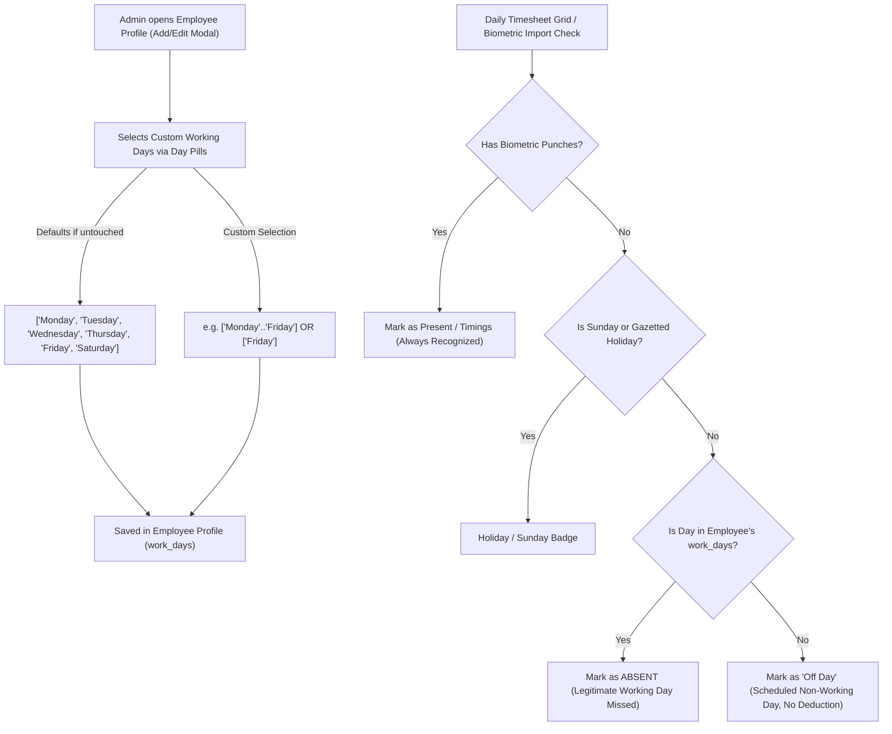

# Custom Employee Working Days (Weekly Schedule) Implementation Plan
**Module:** EdLink Pakistan Attendance Management  
**Scope:** Configurable working days per employee (e.g. 5-day week with Saturday off, Friday-only part-time staff), automated "Off Day" recognition, non-deductible attendance status, and 100% backward compatibility with standard Monday–Saturday defaults.

---

## 1. Executive Summary & Core Rules

### Current Limitation:
- Attendance grid & Excel imports assume a hardcoded **6-day week (Monday to Saturday)** with only **Sunday** as the universal weekly off.
- Employees who have Saturday off or work only on Friday have blank punches on their scheduled non-working days.
- Currently, the system marks these unworked days as **ABSENT** (Red badge), increasing their absent counts and incorrectly triggering salary deductions.

### Solution & Requirements:
1. **Zero Data Disruption:** Purana koi bhi record ya employee data disturb nahi hoga.
2. **Default Fallback:** Agar kisi employee ka custom schedule configure na kiya jaye, system automatically **Monday, Tuesday, Wednesday, Thursday, Friday, and Saturday** (6 days) ko working count karega.
3. **Scheduled Off Recognition:** Non-working days par red "ABSENT" ke bajaye clean neutral **"Off Day"** (Slate/Blue-Grey badge) display hoga.
4. **Extra Day / Overtime Protection:** Agar koi employee apne off day par office aa kar machine par punch karta hai, toh system use "Absent" ya "Off Day" nahi dikhayega balki **"Present"** (Green badge) show karega.
5. **Salary Protection:** "Off Day" ko absent count nahi kiya jayega, lehaza salary se koi katauti (deduction) nahi hogi.

---

## 2. Architectural Design & Data Flow



---

## 3. Step-by-Step Implementation Breakdown (A to Z)

### Phase 1: Data Model & Types Definition
1. **Define Constant (`src/types/database.types.ts`):**
   ```typescript
   export const DAYS_OF_WEEK = [
     'Monday',
     'Tuesday',
     'Wednesday',
     'Thursday',
     'Friday',
     'Saturday',
     'Sunday',
   ] as const

   export const DEFAULT_WORK_DAYS: string[] = [
     'Monday',
     'Tuesday',
     'Wednesday',
     'Thursday',
     'Friday',
     'Saturday',
   ]
   ```
2. **Update Types (`src/types/database.types.ts`):**
   - Add `work_days?: string[]` to the `Employee` interface.
3. **Update Prisma Schema (`prisma/schema.prisma`):**
   - Add `workDays Json? @map("work_days")` to `model Employee`.
4. **Update Mapper (`src/lib/services/attendance.service.ts`):**
   - In `toEmployeeModel`:
     ```typescript
     work_days: (Array.isArray(emp.workDays) && emp.workDays.length > 0)
       ? emp.workDays
       : (Array.isArray(emp.work_days) && emp.work_days.length > 0)
       ? emp.work_days
       : DEFAULT_WORK_DAYS,
     ```
   - In `createEmployee` and `updateEmployee`: persist `work_days` into database & metadata cache.

---

### Phase 2: Employee Form UI (Add / Edit Employee Modal)
**Locations:**
- `src/app/(dashboard)/attendance/page.tsx`
- `src/app/(dashboard)/attendance/employees/page.tsx`

**UI Component:**
Ek interactive 7-day pill selector widget banaya jayega:
```tsx
<div>
  <Label className="text-xs font-bold text-slate-700 uppercase tracking-wider block mb-1.5">
    Working Days Schedule
  </Label>
  <div className="flex items-center gap-1.5 flex-wrap">
    {DAYS_OF_WEEK.map((day) => {
      const isSelected = selectedWorkDays.includes(day)
      return (
        <button
          key={day}
          type="button"
          onClick={() => toggleWorkDay(day)}
          className={`px-3 py-1 rounded-lg text-xs font-bold transition-all cursor-pointer ${
            isSelected
              ? 'bg-[#002D42] text-white shadow-xs'
              : 'bg-slate-100 text-slate-400 hover:bg-slate-200'
          }`}
        >
          {day.slice(0, 3)}
        </button>
      )
    })}
  </div>
  <p className="text-[11px] text-slate-500 mt-1">
    Standard: Mon–Sat. Unselected days will be treated as scheduled "Off Days" (no absent penalty).
  </p>
</div>
```

**Quick Presets (1-Click Shortcuts):**
- **Regular 6-Day** (Mon–Sat)
- **5-Day Corporate** (Mon–Fri)
- **Friday Only** (Fri)

---

### Phase 3: Daily Log Records Grid & Evaluation
**Location:** `src/app/(dashboard)/attendance/records/page.tsx`

1. **Helper Function `isEmployeeScheduledOffDay`:**
   ```typescript
   function isEmployeeScheduledOff(emp: Employee, dateStr: string): boolean {
     const dayName = getDayName(dateStr)
     const workDays = (Array.isArray(emp.work_days) && emp.work_days.length > 0)
       ? emp.work_days
       : DEFAULT_WORK_DAYS
     return !workDays.includes(dayName)
   }
   ```
2. **Status Determination Logic (`getRecordStatusFlags`):**
   - Agar biometric record khali hai:
     - Check: `if (isEmployeeScheduledOff(emp, date))`
     - Return: `isOffDay: true, statusLabel: 'Off Day', isAbsent: false, isPresent: false`
3. **Grid Cell Rendering (`renderCellContent`):**
   - Jab koi record nahi hai (ya unworked hai) aur din employee ka off-day hai:
     ```tsx
     <div
       onClick={() => handleBlankCellClick(emp, date)}
       className="flex items-center justify-center py-2 cursor-pointer select-none"
       title={`Scheduled Off Day (${dayName}) for ${emp.name}. Click to manually add attendance if needed.`}
     >
       <span className="bg-slate-500/80 text-white px-2 py-0.5 rounded text-[10px] font-bold shadow-2xs tracking-wide">
         Off Day
       </span>
     </div>
     ```
4. **Punched on Off Day Case:**
   - Agar kisi employee ki punch exist karti hai (maslan Friday-only employee Tuesday ko aa gaya), toh `rec` object mojood hoga → System normal tarah se In/Out time, working hours aur **Present** dikhayega.

---

### Phase 4: Salary & Monthly Deduction Protection
**Locations:**
- `src/lib/services/attendance.service.ts`
- `src/app/(dashboard)/attendance/employees/[id]/page.tsx`
- `src/app/(dashboard)/attendance/payslips/page.tsx`

1. **Absent Calculation Logic:**
   - Har date par absent tabhi count hogi agar:
     `!hasPunches && !isLeave && !isHoliday && !isSunday && !isOffDay`
   - Is se Friday-only ya 5-day week walon ke non-working days se absent deduction **ZERO** ho jayegi.
2. **Summary Cards:**
   - Monthly summary stats mein "Total Working Days" har employee ke custom schedule ke hisab se dynamically calculate honge.

---

### Phase 5: Excel Sheet & Timesheet Export
**Location:** `src/app/(dashboard)/attendance/records/page.tsx` (ExcelJS generator)

- Jab admin "Export Excel" karega:
  - Scheduled off-days wale cells par **"Off Day"** (ya **"WO"** - Weekly Off) mark hoga with neutral grey background styling, jabke actual absents par red "Absent" rahega.

---

## 4. Verification & Testing Matrix

| Test Scenario | Expected Outcome | Verification |
| :--- | :--- | :--- |
| **Existing Employees (Unmodified)** | Monday–Saturday working, Sunday Holiday | Zero change in past/current behavior. |
| **New Employee without setting schedule** | Monday–Saturday active by default | Zero disruption. |
| **5-Day Employee (Mon–Fri selected, Sat unselected)** | Saturday shows "Off Day" badge instead of "ABSENT" | No salary deduction on Saturday. |
| **Friday-Only Staff (Only Fri selected)** | Sat, Sun, Mon, Tue, Wed, Thu all show "Off Day" | Only Friday is working; no false absents. |
| **Employee punches on their Off Day** | System displays Green Present with In/Out hours | Overtime / extra work is preserved. |
| **Monthly Payslip Generation** | Off days excluded from absent deductions | Gross & net salary calculate accurately. |

---

## 5. Execution Readiness

> [!NOTE]
> Jab aap kal ya jab bhi execution shuru karne ka bolenge, yeh plan bina kisi purane data ko chhede phased steps ke mutabiq complete kar diya jayega.

